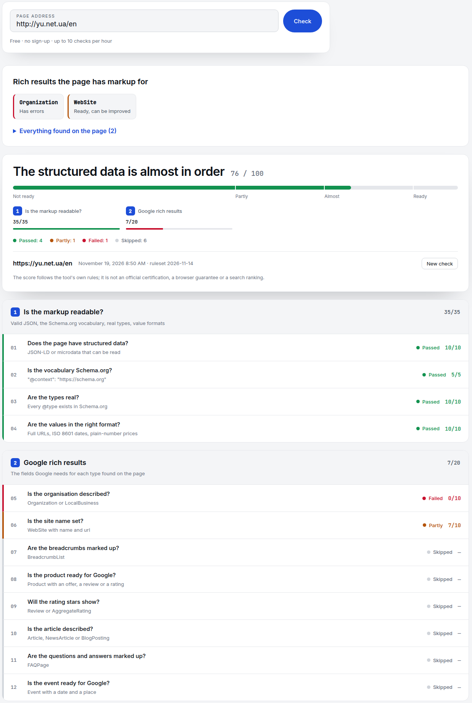

# Schema Validator

[](LICENSE)
[](composer.json)
[](composer.json)
[](composer.json)
[](https://yu.net.ua/en/tools/schema-validator)

A Livewire tool for Laravel that validates a page's Schema.org structured data and checks whether Google can build rich results from it. It reads JSON-LD (including `@graph` and `@id` references) and microdata. It shows the markup as a tree, checks types and value formats against the Schema.org vocabulary, and suggests the right name for a misspelled type.



**🔗 Live example: [yu.net.ua/en/tools/schema-validator](https://yu.net.ua/en/tools/schema-validator)**

## What it checks

12 checks in two groups. The result is a score out of 100 and a verdict.

| Group | Checks |
|---|---|
| **Is the markup readable?** | Structured data present, Schema.org vocabulary, real types, value formats |
| **Google rich results** | Organization, WebSite name, BreadcrumbList, Product, rating stars, Article, FAQ, Event |

A rich result check is skipped, and doesn't lower the score, when its type isn't on the page.

## Requirements

- PHP ^8.4
- Laravel ^13.0
- Livewire ^4.0

## Installation

```bash
composer require yu-laravel/schema-validator
```

This also installs [`yu-laravel/web-tools-core`](https://github.com/yuriyakishin/laravel-web-tools-core). Both service providers are discovered automatically.

## Usage

Put the component on a page whose layout includes `@livewireStyles` and `@livewireScripts`:

```blade
<livewire:schema-validator />
```

Import the styles into your CSS build:

```css
@import "../../vendor/yu-laravel/web-tools-core/resources/css/web-tools-core.css";
@import "../../vendor/yu-laravel/schema-validator/resources/css/schema-validator.css";
```

To match your site's colours and fonts, override the `--wt-*` variables (see [Web Tools Core](https://github.com/yuriyakishin/laravel-web-tools-core#styles)).

## Configuration

| Env variable | Default | Description |
|---|---|---|
| `SCHEMA_VALIDATOR_ENABLED` | `true` | Turn the tool off without uninstalling it. |
| `SCHEMA_VALIDATOR_PER_HOUR` | `10` | Checks per visitor IP per hour. |

A report is cached for 2 minutes, so a fix shows up on the next check. `config/schema-validator.php` also limits the page size (5 MB). Page fetching (timeouts, redirects, user agent) is set in [Web Tools Core](https://github.com/yuriyakishin/laravel-web-tools-core#configuration).

The Schema.org types and their parents are stored in `resources/vocabulary/types.php`. That file was generated from the official `schemaorg-current-https-types.csv`; regenerate it when Schema.org releases a new version.

## Events

- `Yu\SchemaValidator\Events\SchemaValidatorEvent` fires after every finished check: successful, failed or from the cache. It carries `url`, `locale`, `report` (null on failure), `error` and `fromCache`. Listen to it to follow this tool only.
- `Yu\WebToolsCore\Events\ToolCheckedEvent` fires next to it with `tool = "schema-validator"` and the same data, shared by all the web tools (see [Listening to checks](https://github.com/yuriyakishin/laravel-web-tools-core#listening-to-checks)).

## Languages

13 translations: cs, de, en, es, fr, it, ja, nl, pl, pt, tr, uk and zh. The language is taken from the visitor's browser, with your app locale as the fallback.

## Limitations

The tool reads the HTML the server returns. It doesn't see markup that JavaScript adds after the page loads.

## Author

Yuriy Akishin:
- 🌐 Website: https://yu.net.ua
- 📧 Email: yuriy.akishin@gmail.com
- 💼 LinkedIn: https://www.linkedin.com/in/yuriyakishin/
- 💻 GitHub: https://github.com/yuriyakishin

## License

MIT. See [LICENSE](LICENSE).
